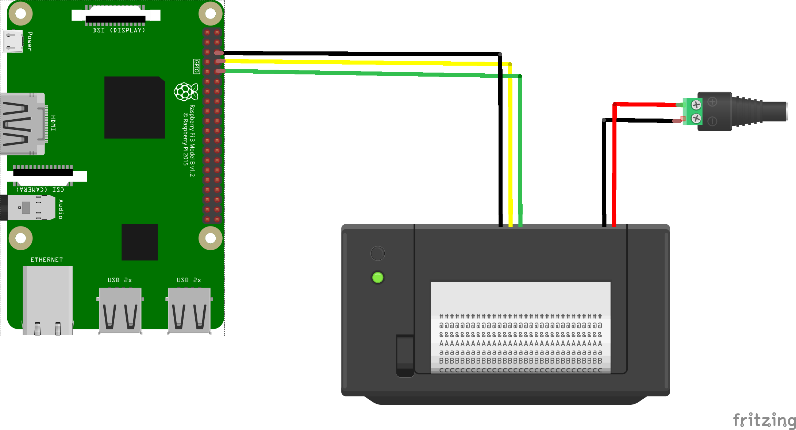

<h1>Using the thermal printer with a Raspberry pi</h1>

<h2>STEP 1: software installation</h2>
power on the raspberry pi and open the terminal 

set up a virtual environment and start it up. You kind find out more on virtual enviroments [here](https://github.com/kingston-hackSpace/Virtual-Environments__RaspberryPi).

```python3 -m venv PROJECT_NAME```

```source PROJECT_NAME/bin/activate```

install Adafruit-Blinka, this library enables some circuit-python commands to work with the pi.

```pip3 install Adafruit-Blinka```

install pyserial, this library enables connection between the pi and the UART serial port

```pip3 install pyserial```

install the adafruit thermal printer library

```install adafruit-circuitpython-thermal-printer```

<h2>STEP 2: hardware setup</h2>



You will need:

- Thermal printer
- 5V Power supply with wire connectors
- Raspberry pi board 

set up the printer with the RX and TX pins reversed (RX to TX) (TX to RX) follow the fritzing diagram above. We use the UART serial pins on the raspberry pi and connect to the thermal printer over a serial connection.

<h2>STEP 3: running the script</h2>

download and the attached script to the project folder then execute it

```python3 thermal_test.py```

the full list of commands can be found from this example script on the [adafruit site](https://learn.adafruit.com/mini-thermal-receipt-printer/circuitpython).
